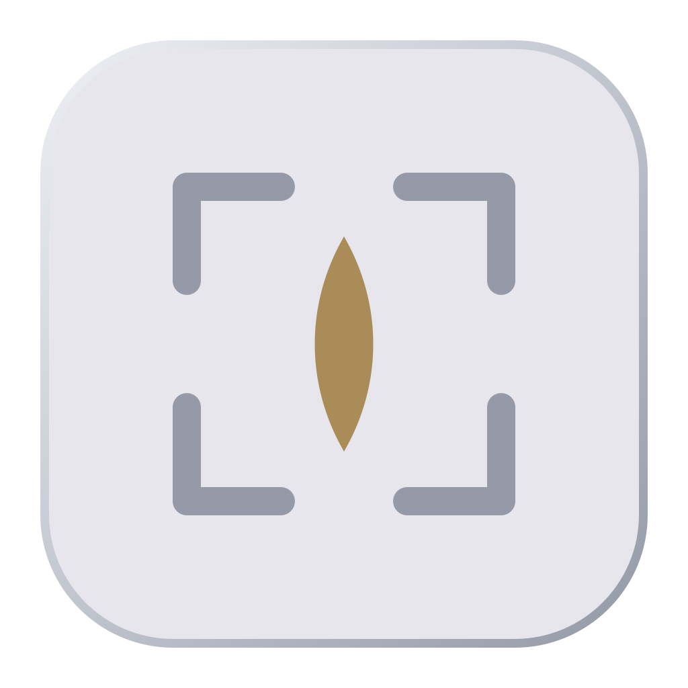

# SHOEV PixelWatch 0.1.4



**Watch anything. Miss nothing.**

A native macOS menu bar utility from SHOEV SYSTEMS / SHOEV PRODUCTS. Select a screen region or application window, set a rule and receive a native notification when it changes. Free under the MIT license. No accounts, subscriptions, network services or third-party dependencies.

[Русский](README.md) · English

## Run

Requires macOS 26.0 or newer. Open `PixelWatch.xcodeproj`, select the **PixelWatch** scheme and run. Xcode 26+ (macOS SDK 26+) is required; development and verification used Xcode 26.3 with the macOS 26.2 SDK. The project uses Swift 5 language mode with complete concurrency checking and Swift Concurrency APIs.

```sh
xcodebuild -project PixelWatch.xcodeproj -scheme PixelWatch \
  -configuration Debug -derivedDataPath build build
open "build/Build/Products/Debug/SHOEV PixelWatch.app"
```

PixelWatch lives in your menu bar. Closing Dashboard leaves monitoring running. Quit from the PixelWatch menu to stop the app.

## Features

- Five real detection modes: Any Visual Change, Text Appears, Text Disappears, Text Changes and Visual Change After Stability.
- System ScreenCaptureKit source picker for one display or window. Only macOS 26.0 and newer are supported.
- Crosshair screen region overlay with move, redraw, dimensions, Return confirmation and Escape cancellation. Display-local coordinates support Retina and monitors with negative desktop origins.
- Desktop-independent window capture follows movement. Window identity includes its owner bundle and process ID; a replacement application instance must be selected explicitly.
- Persistent, shared streams for identical source/region/interval combinations, a latest-frame buffer and serialized analysis for bounded backpressure.
- Local Vision OCR for English and Russian; case-insensitive, whitespace-normalized partial or whole-text matching.
- Two or more confirmations, cooldown, one-shot/continuous rules, explicit pause/restart, source recovery and event history.
- Native notifications with optional sound and navigation to the matching watch.
- Dashboard, watch details, settings, onboarding, launch at login, light/dark appearance and a native platinum/gold/silver app icon.
- No screenshot storage, audio capture, telemetry or network code. Delete all local data from Privacy settings.

## Permissions

The onboarding explains Screen Recording before requesting it. **Settings → Privacy** offers Request Permission and a direct System Settings link. Enable PixelWatch in **Privacy & Security → Screen & System Audio Recording** (wording varies by OS). Quit and reopen if macOS requests it.

A system picker may authorize a source for only the current session. Saved watches need persistent Screen Recording permission after restarting, or use **Select a new source** in watch details to authorize them again. PixelWatch never bypasses Apple permissions.

Notifications are requested after starting your first watch, with an explanation in the rule editor. Denying notifications leaves capture, detection and local event history operational. Enable them later in Settings → Notifications. Focus and macOS notification settings may silence banners or sound.

## Rules and limitations

The default interval is 2 seconds, confirmation count is 2 and cooldown is 30 seconds. All rule parameters are editable. Resuming a paused/triggered watch or changing its rule establishes a fresh baseline.

**Text Disappears** first confirms that the target exists. Empty or low-confidence OCR is inconclusive; use readable replacement text such as “Completed.” A completely blank area does not count as confirmed disappearance. OCR failures never become successful disappearance events.

**Screen Region** watches visible pixels at a fixed display-local rectangle. Covering it with another app changes those pixels. Changing a display's resolution requires reselecting the area; reconnecting the same display is resolved by display UUID. No assumption is made about global monitor order.

**Window Mode** watches the chosen window independently of overlapping windows, as macOS permits. Minimized, closed and protected windows may be unavailable. A window from a relaunched source app is not automatically substituted. Resize changes the window content and can cause a legitimate change event.

Unavailable frames, a stopped stream, sleeping/locked screen, empty capture and uniformly black frames suspend evaluation and clear pending confirmations. Recovery establishes a new baseline. macOS does not provide a universally reliable protected-content flag: uniformly black images are treated conservatively, and partial protected content cannot always be distinguished from real pixels.

The complete UI supports Russian and English, including menus, settings, selection hints, errors, event history and notifications. Russian is the default for fresh installs; switching language in General settings updates existing windows and menu items without restarting. Existing saved language preferences are preserved.

## Verify

```sh
xcodebuild -project PixelWatch.xcodeproj -scheme PixelWatch \
  -configuration Debug -derivedDataPath build \
  -destination 'platform=macOS,arch=arm64' test
swift test
open Demo/index.html
```

Tests use deterministic generated images and mock capture providers; they do not require Screen Recording or notification permissions. The hosted XCTest scheme suppresses app onboarding and monitoring while tests execute. See [manual verification](docs/MANUAL-TESTING.en.md) for all six MVP scenarios, source lifecycle checks and permission checks. See [validation report](docs/VALIDATION.md) for what was actually verified in this environment.

## Release and DMG

```sh
./scripts/build-release.sh
./scripts/create-dmg.sh
open "dist/SHOEV PixelWatch.app"
```

The scripts build an ad-hoc-signed universal app for **arm64 + x86_64** and a compressed DMG with an Applications shortcut. Ad-hoc signing is suitable for local testing; public GitHub/website distribution needs your Developer ID certificate and Apple notarization. See [release instructions](docs/RELEASE.md). No signing credentials or invented project URLs are included.

## Project

```text
PixelWatch.xcodeproj/          Shared application + XCTest scheme
PixelWatch/
  App/                        App delegate, windows, menu bar
  Models/                     Codable configuration, lifecycle, geometry
  Views/                      SwiftUI dashboard, editor, settings, onboarding
  ViewModels/                 Observable store and user actions
  Capture/                    Picker, overlay, stream lifecycle and source resolution
  Recognition/                Local Vision OCR and normalization
  Detection/                  Accelerate image comparison and independent rule engine
  Monitoring/                 Scheduling, suspension, recovery, cancellation
  Notifications/              System notifications and click routing
  Persistence/                Atomic local JSON storage
  Permissions/                Screen Recording and System Settings access
  Resources/                  Info.plist, icon, localization catalog
Tests/                        Detection, rules, OCR, persistence, monitoring
Demo/index.html               Offline manual test lab
scripts/                      Build, DMG, optional project/icon regeneration
```

Architecture: [ARCHITECTURE.md](ARCHITECTURE.md). Privacy: [PRIVACY.md](PRIVACY.md). User guide: [docs/USER-GUIDE.en.md](docs/USER-GUIDE.en.md). Troubleshooting: [docs/TROUBLESHOOTING.md](docs/TROUBLESHOOTING.md).
